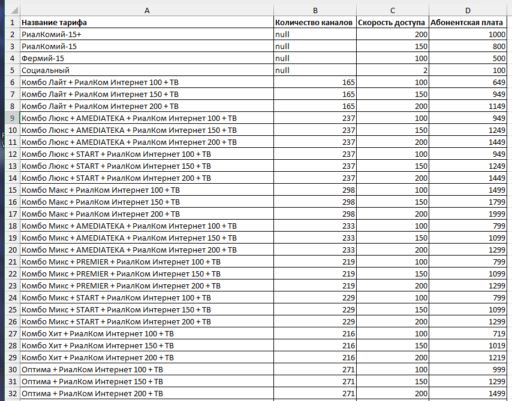

# rialcom-parser

Скрипт для парсинга тарифов интернет-провайдера RialCom (https://www.rialcom.ru/internet_tariffs/).

Собираются тарифы из двух вкладок сайта:

#### Многоквартирные дома
- Блок «Интернет» (4 тарифа)
- Блок «Интернет + Интерактивное ТВ» (36 тарифов)

#### Частные дома и коттеджи
- Блок «Интернет» (5 тарифов)
- Блок «Интернет + Интерактивное ТВ» (36 тарифов)

> [!NOTE]
> Количество тарифов в блоках актуально на момент составления README.

## Требования

- Windows, Linux и macOS
- Python 3.10+
- [Poetry 2.0+](https://python-poetry.org/docs/#installation)

> [!NOTE]
> Проект разрабатывался и тестировался на Windows 11 с Python 3.12.

## Установка

Клонируйте репозиторий проекта
```powershell
git clone https://github.com/Dixter-TES/rialcom-parser.git
```

Перейдите в директорию проекта
```powershell
cd rialcom-parser
```

Установите зависимости и создайте виртуальное окружение
```powershell
poetry install
```

Будут установлены следующие зависимости:

| Библиотека  | Для чего                                            |
|-------------|-----------------------------------------------------|
| `httpx`     | Для загрузки и получения содержимого страницы сайта |
| `selectolax`| Получение информации из HTML-файла страницы         |
| `openpyxl`  | Экспорт результата в Excel-файл                     |

## Запуск

Парсинг с сайта, результат сохранится в `tariffs.xlsx`:

```powershell
poetry run rialcom_parser --output "tariffs.xlsx"
```

Парсинг сохранённой страницы без обращения к сайту (удобно для отладки):

```powershell
poetry run rialcom_parser --output "tariffs.xlsx" --offline "tests/debug.html"
```

### Аргументы

| Аргумент            | Описание                                                      |
|---------------------|---------------------------------------------------------------|
| `--output <файл>`   | Путь к итоговому `.xlsx` файлу                                |
| `--offline <файл>`  | Использовать локальный HTML-файл, вместо обращения к сайту    |

### Пример результата



## Структура проекта

```
src/rialcom_parser/
    config.py    # Конфигурационный файл (регулярки, адрес сайта, идентификаторы и т.д.)
    parser.py    # Парсер HTML
    models.py    # Модели данных
    export.py    # Экспортер в Excel
    utils.py     # Утилиты
    main.py      # Точка входа
tests/
    debug.html   # Тестовая копия страницы сайта
```